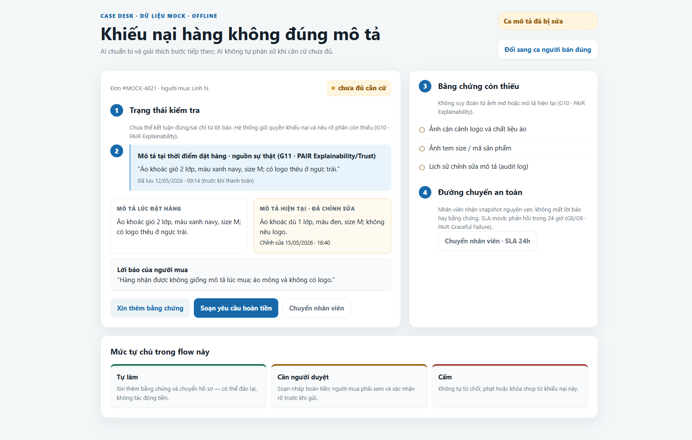
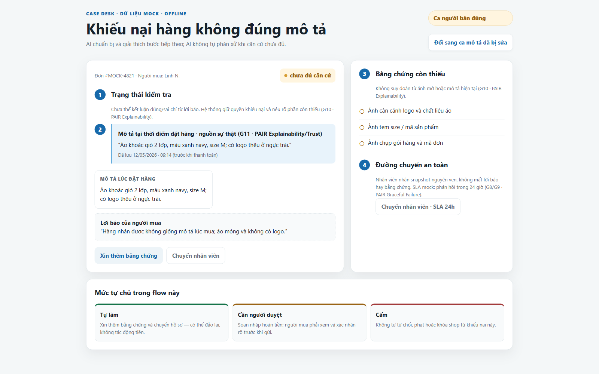

# Prototype LAB5 T4

## Mở và chạy

Mở trực tiếp `prototype/index.html` bằng trình duyệt (double-click hoặc
`Open with…`). Prototype chạy offline bằng HTML/CSS/JavaScript thuần; không cần
cài package, máy chủ, tài khoản hay API key.

## Luồng demo

1. Mở ở **Ca mô tả đã bị sửa**: chỉ ra hai phiên bản mô tả, timestamp và trạng
   thái **chưa đủ căn cứ**.
2. Bấm **Xin thêm bằng chứng** rồi bấm **Hủy gửi** trong cửa sổ 5 giây; UI xác
   nhận chưa gửi tin. Bấm gửi lại và chờ hết 5 giây để xem trạng thái đã gửi,
   không thể thu hồi.
3. Bấm **Soạn yêu cầu hoàn tiền** để mở review; đây là bản nháp, chưa gửi tiền.
4. Đóng review nếu cần, rồi bấm **Chuyển nhân viên · SLA 24h**; snapshot mock
   được giữ nguyên. Bấm **Thu hồi chuyển · đang chờ** để minh họa khả năng thu
   hồi trước khi nhân viên nhận.
5. Bấm **Đổi sang ca người bán đúng**; trạng thái vẫn chưa đủ căn cứ và không có
   nút tự từ chối hay tự hoàn tiền.

## Chú thích và tiêu chí

Các số 1–5 trên giao diện là bằng chứng cho R3 (xử lý thiếu căn cứ), R4 (mức
tự chủ và chuyển người an toàn) và R5 (giải thích, kiểm soát trước tác động):

| Chú thích | Bằng chứng trên màn hình | Mapping chính | R3/R4/R5 |
|---|---|---|---|
| 1 | `Chưa đủ căn cứ`, không kết luận từ lời báo | **G10 · PAIR Explainability**: nói rõ giới hạn | R3, R5 |
| 2 | Mô tả tại thời điểm đặt hàng, có timestamp, là nguồn sự thật | **G11 · PAIR Explainability/Trust**: chỉ ra nguồn và lý do kiểm tra | R3, R5 |
| 3 | Checklist ảnh, mã hàng và audit log còn thiếu | **G10 · PAIR Explainability**: hỏi/thu hẹp thay vì đoán | R3 |
| 4 | Chuyển hồ sơ mock, giữ snapshot, có thể thu hồi khi còn chờ; SLA dự kiến 24 giờ | **G8/G9 · PAIR Graceful Failure**: có đường sửa và thoát an toàn | R4, R5 |
| 5 | Review hoàn tiền là bản nháp, cần checkbox xác nhận | **G8/G9 · PAIR Explainability**: kiểm soát trước tác động | R4, R5 |

R3 được chứng minh bằng việc không phán quyết khi thiếu ảnh/audit; R4 bằng yêu cầu
bằng chứng có 5 giây để hủy, trạng thái đã gửi không thể thu hồi, chuyển hồ sơ có
thể thu hồi khi còn chờ và quyền duyệt của con người; R5 bằng nguồn sự thật, giới
hạn, trạng thái và hành động đều được giải thích.

## Ảnh bằng chứng có đánh số

Các số 1–5 được hiển thị trực tiếp trên giao diện và map tới G10, G11, G8/G9,
PAIR Explainability/Trust và Graceful Failure như bảng trên.

### Ca mô tả bị sửa

### Ca người bán đúng

## Dữ liệu và giới hạn an toàn

- Tất cả đơn hàng, mô tả, timestamp, số tiền, bằng chứng, SLA và thông báo đều
  là **mock data** trong trình duyệt; không gọi Shopee, backend hay dịch vụ thật.
- Prototype chỉ chuẩn bị, giải thích, xin bằng chứng và chuyển hồ sơ. Không tự
  phán quyết khiếu nại, phạt/khóa shop, hủy đơn hoặc gửi tiền thật.
- Cửa sổ 5 giây và trạng thái chuyển/thu hồi là mô phỏng phía trình duyệt. Prototype
  không kết nối hàng đợi và không mô phỏng thời điểm nhân viên nhận hồ sơ; sản phẩm
  thật chỉ cho thu hồi trước sự kiện nhận được xác nhận từ hệ thống.
- Nút hoàn tiền chỉ tạo bản nháp mock và yêu cầu xác nhận rõ ràng; ca người bán
  đúng không có hành động tự từ chối/tự hoàn. Thiếu audit hoặc bằng chứng thì
  giữ trạng thái chưa đủ căn cứ và chuyển người.

## Talking points

- **Hồ Trọng Nghĩa (2A202603729):** giới thiệu lát cắt hàng không đúng mô tả,
  hai ca rủi ro đắt nhất và vì sao phải giữ trạng thái chưa đủ căn cứ.
- **Phạm Đăng Quang (2A202603760):** trình diễn xin bằng chứng, mở bản nháp
  nhưng chưa gửi, chuyển nhân viên; nhấn mạnh mức tự chủ và quyền duyệt.
- **Nguyễn Minh Quân (2A202603747):** chỉ các chú thích 1–5, đổi sang ca người
  bán đúng và đọc mapping G10/G11/G8-G9 cùng PAIR.
